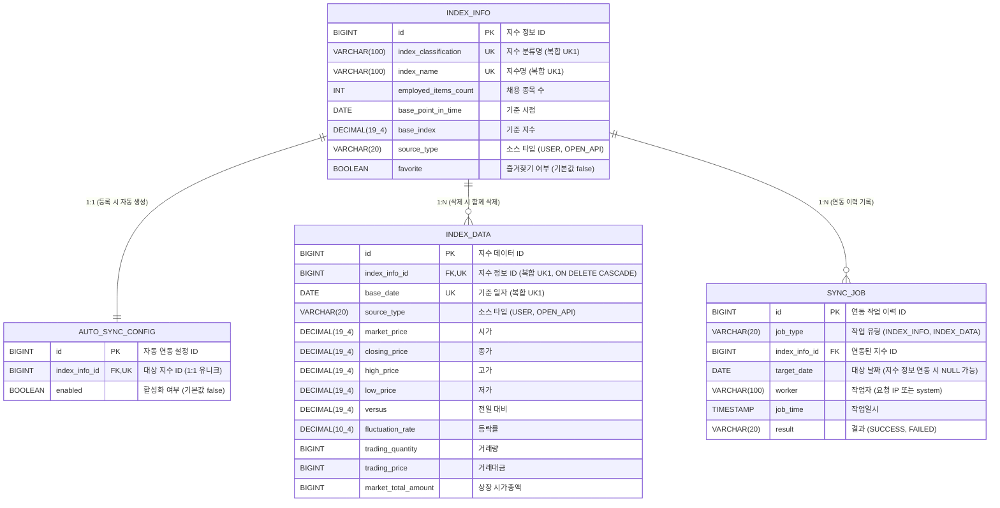

# 1조 - Findex

> 팀 협업 문서: (TODO: Trello / Notion 링크)

## 팀원 구성

| 이름 | GitHub |
| --- | --- |
| (전현진) | [ginkorn](https://github.com/ginkorn) |
| (박석규) | [seok0630](https://github.com/seok0630) |
| (김현수) | [uhae451-wq](https://github.com/uhae451-wq) |
| (최주영) | [ohkr1123-commits](https://github.com/ohkr1123-commits) |

## 프로젝트 소개

- 외부 Open API와 연동해 금융 지수 데이터를 수집·관리하고 대시보드로 제공하는 Spring 백엔드 시스템 구축
- 프로젝트 기간: (2026.10.14 ~ 2026.10.23)

## 기술 스택

- Backend: Spring Boot, Spring Data JPA
- Database: PostgreSQL
- 공통 Tool: Git & GitHub, Trello

## 협업 규칙

### Git 브랜치 전략

| 브랜치 | 용도 |
| --- | --- |
| `main` | 최종 제출 및 배포용 브랜치 |
| `develop` | 개발 내용을 통합하고 테스트하는 브랜치 |
| `feature/기능명` | 개별 기능 개발용 브랜치 |
| `fix/버그명` | 개발 중 발견된 버그 수정용 브랜치 |

- `feature/*`, `fix/*` 브랜치는 `develop`에서 만들고, `develop`으로 PR을 올립니다.
- `main`에는 `develop`을 merge하는 릴리스 PR만 올립니다.

### 리뷰 규칙

- PR을 올리고 팀원 1명 이상의 코드 리뷰와 Approve를 받은 뒤 Merge합니다.
- 페어 프로그래밍으로 진행한 작업은 코드 리뷰를 생략하고 Merge할 수 있습니다.

## 팀원별 구현 기능 상세

### (전현진) - ginkorn

(자신이 개발한 기능에 대한 사진이나 gif 파일 첨부)

- (TODO: 담당 기능)

### (박석규) - seok0630

(자신이 개발한 기능에 대한 사진이나 gif 파일 첨부)

- (TODO: 담당 기능)

### (김현수) - uhae451-wq

(자신이 개발한 기능에 대한 사진이나 gif 파일 첨부)

- (TODO: 담당 기능)

### (최주영) - ohkr1123-commits

(자신이 개발한 기능에 대한 사진이나 gif 파일 첨부)

- (TODO: 담당 기능)

## ER 다이어그램



## 파일 구조

```
com/sprint/mission/sb15findexteam1/
│
├── Sb15FindexTeam1Application.java
│
├── common/                            # [A] 팀 공통 코드
│   ├── config/                        # Swagger·QueryDSL 등 공통 Spring 설정
│   ├── dto/                           # CursorPageResponseDto<T>, ErrorResponse
│   ├── pagination/                    # 커서 해석·생성, 공통 페이지 처리
│   ├── exception/                     # ErrorCode, 공통 예외, 전역 예외 처리
│   └── enums/                         # 여러 도메인이 공유하는 SourceType
│
├── indexinfo/                         # [A] 지수 정보
│   ├── controller/                    # 지수 정보 CRUD·요약 목록 API
│   ├── service/                       # 중복 검증, 수정·삭제·즐겨찾기 처리
│   │                                  # 신규 지수의 자동 연동 설정 생성 연결
│   │                                  # C가 사용할 연동용 등록·갱신 기능
│   ├── repository/                    # 지수 정보 검색·정렬·조회·저장
│   ├── entity/                        # IndexInfo
│   ├── dto/                           # 등록·수정·검색·연동 저장 입력, 조회 응답
│   └── mapper/                        # IndexInfo ↔ DTO 변환
│
├── indexdata/                         # [B] 지수 데이터
│   ├── controller/                    # 지수 데이터 CRUD·목록·CSV API
│   ├── service/                       # 중복 검증, 데이터 등록·수정·삭제
│   │                                  # 목록 조회·CSV 생성
│   │                                  # C가 사용할 연동용 등록·갱신 기능
│   │                                  # D가 사용할 지수·기간별 데이터 조회 기능
│   ├── repository/                    # 데이터 조회·저장, 동적 필터·정렬
│   ├── entity/                        # IndexData
│   ├── dto/                           # 등록·수정·검색·연동 저장 입력, 조회 응답
│   └── mapper/                        # IndexData ↔ DTO 변환
│
├── autosyncconfig/                    # [A] 자동 연동 설정
│   ├── controller/                    # 설정 목록 조회·활성화 여부 변경 API
│   ├── service/                       # 기본 설정 생성·설정 변경·활성화 대상 조회
│   ├── repository/                    # 자동 연동 설정 조회·저장
│   ├── entity/                        # AutoSyncConfig
│   ├── dto/                           # 설정 검색·변경 요청, AutoSyncConfigDto
│   └── mapper/                        # 설정과 지수 정보를 조회 응답으로 변환
│
├── openapi/                           # [C] 외부 금융위원회 API 통신
│   ├── client/                        # OpenApiClient: 외부 HTTP 요청·페이징 처리
│   ├── dto/                           # 외부 API 응답 형식에 대응하는 DTO
│   ├── config/                        # 외부 API 주소·인증키·HTTP 클라이언트 설정
│   └── exception/                     # 외부 API 오류·응답 해석 실패 표현
│
├── syncjob/                           # [C] 연동 실행·기록 / [D] 이력 조회
│   ├── controller/                    # [C] 연동 실행 API / [D] 연동 이력 조회 API
│   ├── service/                       # [C] 연동 실행·성공/실패 기록 / [D] 이력 검색·정렬·페이지 조회
│   ├── repository/                    # [C] 기본 저장 Repository
│   │                                  # [D] 이력 목록 조회용 커스텀 쿼리
│   ├── entity/                        # [C] SyncJob, D도 같은 엔티티를 조회
│   ├── dto/                           # [C] IndexDataSyncRequest
│   │                                  # [D] 이력 검색 요청
│   │                                  # [C·D] 실행 결과·목록에서 공유할 SyncJobDto
│   ├── mapper/                        # [C·D] SyncJob → 응답 DTO 변환
│   ├── enums/                         # [C] JobType, ResultType
│   └── scheduler/                     # [C] AutoSyncScheduler: 일 단위 자동 실행
│
└── dashboard/                         # [D] 차트·성과·랭킹
    ├── controller/                    # 차트·관심 지수 성과·성과 랭킹 API
    ├── service/                       # 기간별 차트 구성, MA5·MA20 계산
    ├── repository/                    # IndexData 읽기 전용 조회       
    ├── dto/                           # 차트·이동평균·성과·랭킹 응답
    └── mapper/                        # 조회·계산 결과 → 응답 DTO 변환
```
비교적 작은 프로젝트 규모로 도메인형 채택

## 구현 홈페이지

(TODO: 배포 링크)

## 프로젝트 회고록

(TODO: 발표자료 링크 또는 첨부파일)
