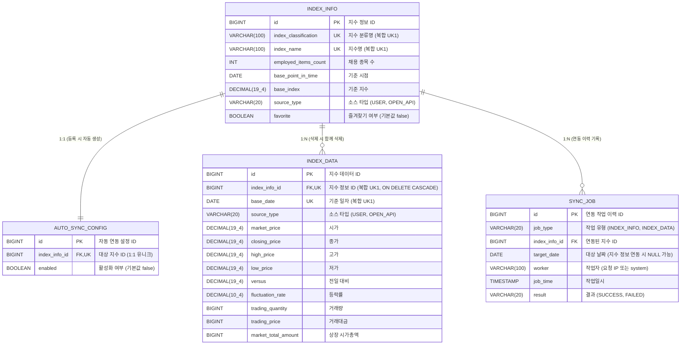

# 1조 - Findex

> 팀 협업 문서: (TODO: Trello / Notion 링크)

## 팀원 구성

| 이름 | GitHub |
| --- | --- |
| (전현진) | [ginkorn](https://github.com/ginkorn) |
| (박석규) | [seok0630](https://github.com/seok0630) |
| (김현수) | [uhae451-wq](https://github.com/uhae451-wq) |
| (최주영) | [ohkr1123-commits](https://github.com/ohkr1123-commits) |

## 프로젝트 소개

- 외부 Open API와 연동해 금융 지수 데이터를 수집·관리하고 대시보드로 제공하는 Spring 백엔드 시스템 구축
- 프로젝트 기간: (2026.10.14 ~ 2026.10.23)

## 기술 스택

- Backend: Spring Boot, Spring Data JPA
- Database: PostgreSQL
- 공통 Tool: Git & GitHub, Trello

## 협업 규칙

- `main` 브랜치를 기준으로 `feature/{작업명}` 브랜치를 만들어 작업합니다.
- PR을 올리고 팀원 1명 이상의 코드 리뷰와 Approve를 받은 뒤 Merge합니다.
- 페어 프로그래밍으로 진행한 작업은 코드 리뷰를 생략하고 Merge할 수 있습니다.

## 팀원별 구현 기능 상세

### (전현진) - ginkorn

(자신이 개발한 기능에 대한 사진이나 gif 파일 첨부)

- (TODO: 담당 기능)

### (박석규) - seok0630

(자신이 개발한 기능에 대한 사진이나 gif 파일 첨부)

- (TODO: 담당 기능)

### (김현수) - uhae451-wq

(자신이 개발한 기능에 대한 사진이나 gif 파일 첨부)

- (TODO: 담당 기능)

### (최주영) - ohkr1123-commits

(자신이 개발한 기능에 대한 사진이나 gif 파일 첨부)

- (TODO: 담당 기능)

## ER 다이어그램



## 파일 구조

```
com.sprint.mission.sb15findexteam1/
├── Sb15FindexTeam1Application.java
├── indexinfo/          # 지수 정보
│   ├── controller/
│   ├── service/
│   ├── repository/
│   ├── entity/
│   └── dto/
├── indexdata/          # 지수 데이터
│   ├── controller/
│   ├── service/
│   ├── repository/
│   ├── entity/
│   └── dto/
├── autosyncconfig/     # 자동 연동 설정
├── syncjob/            # 연동 이력
└── common/
    ├── dto/           # 공통 페이지 응답
    ├── exception/     # 공통 예외 처리
    └── config/        # 공통 설정
```
비교적 작은 프로젝트 규모로 도메인형 채택

## 구현 홈페이지

(TODO: 배포 링크)

## 프로젝트 회고록

(TODO: 발표자료 링크 또는 첨부파일)
